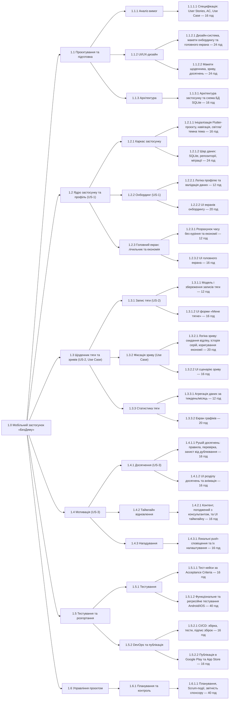

# Лабораторна робота №6

**Тема:** Декомпозиція робіт (WBS) на основі користувацьких історій
**Виконав:** Мезенцев Антон, група КН-23

**Проєкт:** мобільний застосунок «БезДиму» (базова версія: Flutter, локальне сховище SQLite, без сервера). Основа декомпозиції: User Stories US-1 (онбординг), US-2 (щоденник тяги), US-3 (досягнення) та Use Case «Фіксація зриву та перезапуск відліку» з Лабораторної роботи №5.

---

## Крок 1. WBS-діаграма

### Перевірка «Правила 100%»

| Блок рівня 2 | Що покриває | Сума пакетів робіт |
|---|---|---|
| 1.1 Проєктування та підготовка | Вимоги, дизайн, архітектура | 80 год |
| 1.2 Ядро та профіль | US-1 + каркас, від якого залежать усі функції | 100 год |
| 1.3 Щоденник тяги та зривів | US-2 + Use Case + статистика | 96 год |
| 1.4 Мотивація | US-3 + таймлайн + нагадування | 64 год |
| 1.5 Тестування та розгортання | QA та DevOps | 88 год |
| 1.6 Управління проєктом | Робота PM / Scrum Master | 40 год |
| **1.0 Разом** | | **468 год** |

Дочірні елементи кожного рівня повністю покривають батьківський: усі функції з Product Backlog (Лаб. №3) і всі вимоги з Лаб. №5 мають свій пакет робіт, а робіт поза узгодженим обсягом (наприклад, хмарної синхронізації чи реєстрації) у дереві немає. Управлінська робота теж входить в обсяг, тому виділена в окремий блок 1.6.

---

## Крок 2. Валідація пакетів робіт за «Правилом 8/80»

| Код WBS | Назва пакета робіт | Напрям | Тривалість | Виконавець | 8–80 год? |
|---|---|---|---|---|---|
| 1.3.2.1 | Логіка зриву: скидання відліку, історія серій, коригування економії | Backend (локальний шар даних і бізнес-логіки) | 20 год | Flutter-розробник (Dart, SQLite) | Так |
| 1.3.1.2 | UI форми «Мене тягне» | Frontend / Client | 16 год | Flutter-розробник (UI) | Так |
| 1.5.1.2 | Функціональне та регресійне тестування Android/iOS | QA | 40 год | QA-інженер | Так |
| 1.5.2.1 | CI/CD: збірка, тести, підпис збірок | DevOps | 16 год | DevOps-інженер | Так |

Усі пакети робіт у дереві мають тривалість від 12 до 40 годин, тобто вкладаються в діапазон 8–80 годин: вони достатньо великі, щоб не перетворювати управління на мікроменеджмент, і достатньо малі, щоб їх можна було оцінити й відстежити.

---

## Крок 3. Словник WBS (WBS Dictionary)

| Параметр Словника WBS | Пакет робіт №1 (Backend / шар даних) | Пакет робіт №2 (Frontend / Client) |
|---|---|---|
| **Код та назва WBS:** | 1.3.2.1 Логіка зриву: скидання відліку, історія серій, коригування економії | 1.3.1.2 UI форми «Мене тягне» |
| **Батьківська вимога (Лаб №5):** | Use Case «Фіксація зриву та перезапуск відліку» | US-2 «Щоденник тяги» |
| **Технічний опис задачі:** | Таблиці relapses і streak_history в SQLite (з міграцією); метод збереження зриву (дата, кількість сигарет, тригер); скидання дати відмови з перенесенням попередньої серії в історію рекордів; альтернативний сценарій без скидання з відніманням вартості сигарет від економії; збереження вже отриманих досягнень | Кнопка «Мене тягне» на головному екрані; bottom sheet із вибором сили тяги (1–5) і тригера (необов'язковий, за замовчуванням «Не вказано»); кнопка «Зберегти»; повідомлення «Записано. Ти впораєшся!»; адаптивність під різні розміри екранів |
| **Відповідальна роль:** | Flutter-розробник (Dart, SQLite) | Flutter-розробник (UI) |
| **Критерії завершення (DoD / Acceptance):** | Unit-тести покривають ≥ 80 % коду, включно з обома сценаріями (зі скиданням і без); дані зберігаються після перезапуску застосунку; Code Review пройдено | Виконуються Acceptance Criteria US-2 з Лаб. №5; форма відповідає макету; запис робиться не більше ніж за 3 дотики; лічильник після запису не скидається; немає помилок у логах |
| **Необхідні ресурси та залежності:** | Готовий шар даних (1.2.1.2); затверджена схема БД (1.1.3.1) | Макет у Figma (1.1.2.2); метод збереження записів тяги (1.3.1.1) |
| **Оцінка трудомісткості:** | 20 годин | 16 годин |

---

## Контрольні запитання

### 1. У чому полягає суть «Правила 100%» при побудові WBS та як воно запобігає Scope Creep?

**Правило 100%:** WBS охоплює **весь** обсяг робіт проєкту (включно з управлінням) і **нічого понад нього**, а сума дочірніх елементів на кожному рівні дорівнює 100 % батьківського. Воно запобігає Scope Creep, бо дерево стає формальною межею обсягу: будь-яка робота, якої немає в WBS, вважається новою, і її не можна виконати «непомітно». Таку роботу треба офіційно погодити (Change Request або беклог), перерахувавши терміни й бюджет.

### 2. Чому пакети робіт не рекомендується дробити менше 8 годин або об'єднувати у блоки понад 80 годин?

- **Менше 8 годин:** задач стає забагато, PM тоне в мікроменеджменті, а на облік, оцінку й звітність іде більше часу, ніж на саму роботу.
- **Понад 80 годин:** таку роботу важко точно оцінити, ризики в ній приховані, а прогрес довго не видно (задача тижнями «виконана на 90 %»). Проблему помічають запізно.

Діапазон 8–80 годин (від 1 до 10 робочих днів) дає баланс між контролем і накладними витратами.

### 3. Чим відрізняється дерево WBS від організаційної структури команди (OBS) та від беклогу задач у Scrum?

- **WBS** відповідає на питання **«Що треба зробити?»**: ієрархічна декомпозиція результатів (deliverables) і робіт проєкту.
- **OBS (Organizational Breakdown Structure)** відповідає на питання **«Хто це робить?»**: ієрархія команди, ролей і підрозділів. Перетин WBS і OBS дає матрицю відповідальності (RACI).
- **Scrum-беклог** є **пласким списком, упорядкованим за пріоритетом**, і постійно змінюється. Він описує цінність для користувача (User Stories), а не повну ієрархію робіт. WBS натомість фіксує весь обсяг наперед і використовується для оцінки строків і бюджету, особливо в предиктивних проєктах.

### 4. Яку роль відіграє Словник WBS у врегулюванні спорів щодо приймання робіт замовником?
